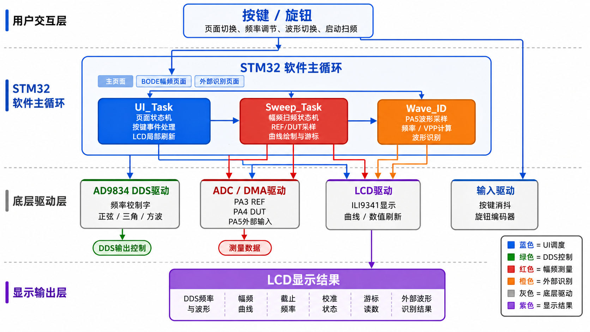

# 基于 DDS 的信号发生器与幅频特性测试仪

    

本项目使用 STM32F103C8T6 和 AD9834 产生测试信号，用两路 AD8307 测量待测电路的幅频响应，并在 ILI9341 液晶屏上显示结果。通过旋转编码器和四个按键即可操作，也可接入外部信号进行基本波形识别。

## 开源资料

本仓库提供固件源码、Keil MDK 工程、STM32CubeMX 配置、接线与校准文档，以及测量算法的主机端测试。硬件设计资料计划通过立创开源硬件平台发布，项目页地址将在发布后补充。

本项目原创固件、配套文档和测试代码采用 [MIT 许可证](LICENSE)。第三方组件及其许可见 [NOTICE.md](NOTICE.md)。硬件许可随硬件工程发布。

## 功能与测量范围

| 功能 | 说明 |
| --- | --- |
| DDS 信号发生 | 可选择正弦波、三角波和方波，固件频率设定范围为 1 Hz 至 10 MHz。实际输出幅度和波形质量随频率、模拟链路和负载变化。 |
| 幅频测量 | 使用正弦激励，在 100 Hz 至 10 MHz 范围内完成 81 点近似对数扫频。支持曲线显示、插值游标、低通／高通／带通判断及 −3 dB 截止频率估算。 |
| 直通校准 | 逐频点记录直通偏差，并在普通测量时应用补偿。校准表和上次曲线保存在 RAM，掉电后需重新校准。 |
| 外部波形识别 | 每次分析 1024 个采样点，采样率在 20、100、600 kS/s 三档间切换。支持识别正弦波、三角波和方波，显示频率估计值及 PA5 ADC 侧峰峰值。 |

## 测量原理

- **信号发生**　STM32 通过 SPI2 配置 AD9834。模拟开关选择波形路径，OPA690 提供交流放大和输出驱动。
- **幅频测量**　REF 和 DUT 通道分别检测待测网络的输入与输出。固件按约 25 mV/dB 的典型斜率将两路 AD8307 输出电压之差换算为增益，再应用固定偏移和可选的逐点直通补偿。每个频点采集三轮，每轮对每路平均 96 次，取三轮结果的中值。
- **外部识别**　外部信号经 OPA2354 衰减、偏置和缓冲后送入 PA5，由 TIM3 触发 ADC 和 DMA 采样。固件通过带滞回的过阈值事件估算频率，结合峰值因数、平均绝对幅度比例和曲率判断波形。

## 编译与上手

1. 用 Keil MDK 5 打开 [DDS_F103.uvprojx](MDK-ARM/DDS_F103.uvprojx)。工程使用 Arm Compiler 6，配置的器件包为 `Keil.STM32F1xx_DFP.2.4.1`，目标器件为 STM32F103C8。
2. 编译后通过 SWD 下载。首次使用自己的 ST-LINK 时，在 Keil 调试器设置中选择对应探头。扩展固件时需关注目标芯片的 64 KiB Flash 容量和工程优化配置。
3. 测量前用线缆直连 `TEST_IN` 和 `TEST_OUT`。按 `MODE` 进入 BODE 页面，按 `STEP` 选到 `NEXT:CAL`，按 `SWEEP` 执行直通校准。
4. 接入待测电路，将其输入接 `TEST_IN`，输出接 `TEST_OUT`，共地。选择 `NEXT:MEAS` 并启动扫频。确认 `CORR:ON` 已启用，完成后转动编码器查看游标读数。

实测结果会随被测网络的源阻抗、负载及接线变化，尤其是高 Q 的 LC 网络。81 点扫频适合观察曲线趋势和估算截止频率。外部波形识别在低幅度或每周期采样点较少时更易出现混淆，也可能因混叠产生错误的频率估计。

## 目录与文档

| 路径 | 内容 |
| --- | --- |
| [Core](Core) | 应用、板级驱动及 CubeMX 初始化代码。主要参数见 [project_config.h](Core/Inc/project_config.h)。 |
| [Drivers](Drivers) | STM32F1xx HAL 和 CMSIS |
| [MDK-ARM](MDK-ARM) · [DDS_F103.ioc](DDS_F103.ioc) | Keil 工程和 STM32CubeMX 配置 |
| [系统架构](docs/DDS_architecture.md) · [固件与接线指南](docs/STM32_DDS_Project_Guide.md) | 信号路径、引脚定义、固件配置和按键操作 |
| [AD8307 测试与校准](docs/ad8307_test.md) · [旧版实测记录](docs/test.md) | 检波通道测试方法及旧版调理板数据 |
| [Tests/Host](Tests/Host) | 测量算法的主机端测试 |
